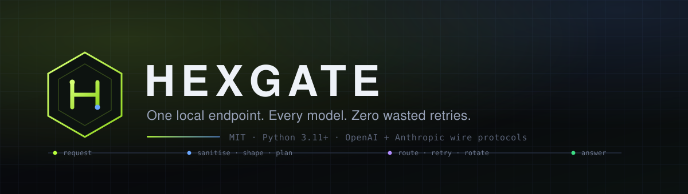

<p align="center">
  
</p>

<p align="center">
  <a href="https://github.com/code-with-idrees/hexgate/actions/workflows/ci.yml"></a>
  <a href="LICENSE"></a>
  
  
  
</p>

# Hexgate

**One local endpoint. Every model. Zero wasted retries.**

Hexgate is a local gateway that sits between your coding agent and every model provider you
have access to. Point Claude Code, OpenCode, Aider or any OpenAI/Anthropic-compatible client
at `http://127.0.0.1:8787` and it will route each turn to the best provider you have
configured — translating protocols, rotating keys, failing over, and keeping the agent in the
loop while providers misbehave.

It is a small Python service (four runtime dependencies), a hand-written dashboard with no
build step, and a catalog of **41 providers** that is data, not code.

```text
Claude Code ─┐                          ┌─> Groq
OpenCode ────┤   Anthropic / OpenAI     │   OpenRouter
Aider ───────┼──> 127.0.0.1:8787 ──────┼─> NVIDIA NIM
your client ─┘   route · retry · shape  └─> your local vLLM
```

---

## Why another gateway?

Coding agents assume one provider. The moment you use free tiers, that assumption costs you:
a 429 ends the turn, a dead model breaks the session, a bad key stalls the loop, and every
provider wants its own SDK, base URL and wire format.

Hexgate treats provider unreliability as the normal case.

- **Retries that know when to stop.** 5xx, 429, timeouts and dead keys are retried on the next
  route. A malformed prompt (`400`) is returned immediately instead of burning six providers.
- **Circuit breakers per route.** A route that keeps failing is skipped for a cooldown, then
  given a single half-open trial. One dead provider cannot eat every request's timeout budget.
- **Key rotation.** Add two keys to a provider and a 401/429 on the first cools it while the
  second keeps the turn alive. `Retry-After` is honoured.
- **Both wire protocols, both directions.** Anthropic clients can use OpenAI-shaped providers.
  OpenAI clients can use Anthropic-shaped providers. Streaming is translated frame by frame,
  including tool calls and thinking blocks.
- **Tier routing.** `claude-opus-*`, `claude-sonnet-*`, `claude-haiku-*` and `fable` each get
  their own chain, so Claude Code's `/model` picker still means something.
- **A route planner you can read.** `hexgate route sonnet` prints the exact candidate order and
  why anything was skipped — before you send a single token.
- **Token shaping with receipts.** Trim, dedupe and truncate tool output, then see exactly which
  rule saved how many tokens. No external binary, no second service.
- **Keys encrypted at rest.** AES-256-GCM, machine-bound by default, never written to
  `config.toml`, never returned unmasked by the API.
- **Small surface area.** `fastapi`, `uvicorn`, `httpx`, `cryptography`. The UI is three static
  files. There is no Node toolchain and no database.

## How it compares

Hexgate is inspired by [Free Claude Code](https://github.com/Alishahryar1/free-claude-code)
(FCC). Both scratch the same itch; they make different trade-offs.

| | Free Claude Code | Hexgate |
| --- | --- | --- |
| License | AGPL-3.0-only | **MIT** |
| Provider catalog | 61 providers | 41 providers, JSON-driven and opt-in |
| Agent support | 11 first-class launchers | **4 launchers** + any OpenAI/Anthropic client |
| Protocols | Anthropic entry point, per-provider adapters | **Both directions**, including streaming tool calls |
| Codex CLI | Supported | **Supported via `/v1/responses`** |
| Failover | Ordered fallback models | Tier + default chains, retry classification, **per-route circuit breakers** |
| API keys | Numbered keys, choose one per model | **Automatic rotation** with per-key cooldowns |
| Token savings | Optional RTK / Headroom | **Built-in shaping** with a per-rule report |
| Key storage | Environment / `.env` | **AES-256-GCM vault**, masked API |
| Observability | Dashboard | Dashboard + **Prometheus `/metrics`** + request records + cost estimates |
| Runtime dependencies | Larger stack | `fastapi`, `uvicorn`, `httpx`, `cryptography` |
| Extras | OAuth subscriptions, browser sessions, bots, voice, tray app | Focused on the gateway; no bots or tray app |

**Choose FCC instead if** you want ChatGPT/Copilot OAuth subscription access, Discord/Telegram
bots, voice notes, browser-hosted Codex sessions, or the very longest provider list. Those are
real features and FCC does them well.

**Choose Hexgate if** you want a small MIT-licensed service you can read end to end, precise
control over how failures are handled, both wire protocols plus the OpenAI **Responses API** for
Codex CLI, encrypted keys, and metrics that plug into the monitoring you already run.

## Install

Requires **Python 3.11+**. No Node, no database, no compiler.

```bash
pipx install git+https://github.com/code-with-idrees/hexgate.git
```

With `uv`:

```bash
uv tool install git+https://github.com/code-with-idrees/hexgate.git
```

From source:

```bash
git clone https://github.com/code-with-idrees/hexgate.git
cd hexgate
python -m venv .venv
# Windows: .venv\Scripts\activate        macOS/Linux: source .venv/bin/activate
pip install -e ".[dev]"
```

Docker:

```bash
docker build -t hexgate .
docker run --rm -p 127.0.0.1:8787:8787 -v hexgate-data:/data hexgate
```

The image binds `0.0.0.0` inside the container and enables remote access because
Docker's NAT makes even host clients look non-loopback. Publish the port to
`127.0.0.1` (as above) unless you have a TLS proxy or VPN in front, and set both
auth tokens before exposing it. `docker compose up -d` uses the same defaults.

One-line installer (isolated venv; prefers pipx or uv when present):

```bash
curl -fsSL https://raw.githubusercontent.com/code-with-idrees/hexgate/main/scripts/install.sh | sh
```

```powershell
irm https://raw.githubusercontent.com/code-with-idrees/hexgate/main/scripts/install.ps1 | iex
```

## Quickstart

```bash
hexgate init                 # create ~/.hexgate + a commented config.toml
hexgate keys set groq        # paste a key; the provider is enabled automatically
hexgate serve                # dashboard at http://127.0.0.1:8787
```

Then either use the dashboard (**Routing** → pick a model for each tier) or point an agent at
the gateway:

```bash
# Claude Code
hexgate launch claude

# OpenCode
hexgate launch opencode

# Aider (base URL is injected for you)
hexgate launch aider
```

Anything that accepts a custom base URL works too:

```bash
# Anthropic-compatible clients
export ANTHROPIC_BASE_URL=http://127.0.0.1:8787
export ANTHROPIC_API_KEY=hexgate-local

# OpenAI-compatible clients
export OPENAI_BASE_URL=http://127.0.0.1:8787/v1
export OPENAI_API_KEY=hexgate-local
```

`hexgate env --shell powershell` prints the same values for Windows. If you set a proxy token,
use it as the API key value; the launchers read it from `config.toml` automatically.

> **Codex CLI is not supported.** Current Codex requires the OpenAI Responses API for custom
> providers and no longer accepts `wire_api = "chat"`. Hexgate proxies Chat Completions and
> Anthropic Messages only. See [client compatibility](docs/compatibility.md#codex-cli) for
> details and alternatives.

## Routing

A request is resolved in this order:

1. **Direct reference** — `groq/llama-3.3-70b-versatile` goes to exactly that route.
2. **Tier chain** — a model containing `sonnet`, `opus`, `haiku` or `fable` uses that tier's
   chain (this is what Claude Code's model picker sends).
3. **Default chain** — every configured `default_chain` entry, in order.
4. **Implicit** — if no chains exist, enabled providers' default models in tier order.

The resulting candidate list is de-duplicated, filtered by circuit state, ordered by your
strategy, and pinned to a specific key. Failover walks that list up to `max_attempts`.

```toml
[routing]
strategy = "quality"          # quality | cheapest | fastest | round_robin
max_attempts = 4
timeout = 120.0
connect_timeout = 10.0
cooldown_seconds = 60.0
failure_threshold = 3

default_chain = ["groq/llama-3.3-70b-versatile", "cerebras/llama-3.3-70b"]
sonnet_chain  = ["openrouter/anthropic/claude-sonnet-4.5", "groq/llama-3.3-70b-versatile"]
opus_chain    = ["nvidia_nim/meta/llama-3.3-70b-instruct"]
haiku_chain   = ["cerebras/llama-3.1-8b"]
```

Explain any decision before sending traffic:

```bash
$ hexgate route claude-sonnet-4-5
request : claude-sonnet-4-5
tier    : sonnet
source  : tier
  1. openrouter/anthropic/claude-sonnet-4.5  (key 1, openai)
  2. groq/llama-3.3-70b-versatile            (key 1, openai)
```

`--json` gives the same plan to scripts, and the dashboard's **Routing** view has a live planner.

### Retry policy

| Upstream result | Behaviour |
| --- | --- |
| `408`, `409`, `425`, `429`, `500`, `502`, `503`, `504`, `520`, `522`, `523`, `524`, `529` | Retry the next candidate; open the route circuit after `failure_threshold` |
| `401`, `403` | Cool that **key** only, retry with the next key or route; never open the circuit |
| `400`, `404`, `422` **with** a model/deployment hint in the body | Retry (the model id is wrong for that provider) |
| Any other `4xx` | Return to the client immediately with the upstream message |
| Network error / timeout | Count as a failure, retry the next candidate |

`Retry-After` is respected. A 429 cools the route for up to 15 minutes and the key for up to
10 minutes, capped so a hostile header cannot wedge the gateway.

## The token optimizer

Enabled by default, applied to the canonical request before it leaves the gateway:

| Rule | What it does |
| --- | --- |
| `whitespace` | Strips trailing spaces on every line (huge in pasted logs) |
| `strip-empty` | Drops empty user/tool turns that providers bill for |
| `dedupe-system` | Merges multiple system/developer prompts and removes duplicate paragraphs |
| `truncate-tool-output` | Keeps the head and tail of oversized tool results and inserts an explicit `[hexgate: truncated N characters]` marker |

Every request record carries the tokens saved, and the dashboard shows savings per rule. Turn
individual rules off in `[optimizer]`; the goal is to remove waste, not to rewrite prompts.

## Dashboard and API

`hexgate serve` opens a dashboard with seven views: Overview, Providers, Routing, Activity,
Playground, Models and Settings. It is served from the same origin as the proxy, protected by
the same loopback guard, and built from three static files.

Proxy endpoints:

| Method | Path | Protocol |
| --- | --- | --- |
| `POST` | `/v1/messages` | Anthropic Messages (streaming + tools) |
| `POST` | `/v1/messages/count_tokens` | Anthropic token estimate |
| `POST` | `/v1/chat/completions` | OpenAI Chat Completions (streaming + tools) |
| `GET` | `/v1/models` | Combined model list (`hexgate/sonnet`, `provider/model`, …) |
| `GET` | `/healthz` | Liveness, version, uptime (always public) |
| `GET` | `/metrics` | Prometheus exposition |
| `GET` | `/` | Dashboard |

Admin API (all under `/api`): `overview`, `providers`, `providers/{id}`, keys, provider test and
model discovery, `routes/plan`, `routes/chains`, `routes/models`, `health`, `requests`, `stats`,
`playground`, `config`, `config/export`, `diagnostics`. The dashboard is a client of this API;
the CLI uses it too where a running server is useful.

Response headers include `x-hexgate-route`, `x-hexgate-attempts` and `x-hexgate-request-id` so
you can see which provider actually answered a turn.

## CLI

| Command | Purpose |
| --- | --- |
| `hexgate serve [--port N] [--host H] [--no-browser]` | Start the gateway + dashboard |
| `hexgate init` | Create `~/.hexgate`, write a commented config, print next steps |
| `hexgate keys set <provider>` | Add a key (prompted, encrypted, auto-enables the provider) |
| `hexgate keys list \| remove \| reset --all` | Manage the vault |
| `hexgate providers` | Catalog + key status |
| `hexgate models [--json]` | Every routable `provider/model` slug |
| `hexgate route <model> [--json]` | Explain the failover plan |
| `hexgate doctor` | Environment, secrets, routing and server checks |
| `hexgate config show \| path \| export` | Inspect configuration |
| `hexgate env [--shell bash\|powershell\|json]` | Print agent environment variables |
| `hexgate launch <agent> [args…]` | Start an agent pointed at Hexgate |
| `hexgate version` | Version |

`launch` accepts `claude`, `opencode`, `aider`, or `custom --bin <path>`.

## Providers

41 providers ship in the catalog: free tiers, paid APIs, subscription plans, and local servers.
Every entry is **disabled until you opt in**, so a fresh install never sends data anywhere by
accident. Adding a key enables the provider.

Highlights: OpenRouter, NVIDIA NIM, Groq, Google AI Studio, Cerebras, Mistral, DeepSeek,
OpenAI, Anthropic, xAI, Together, DeepInfra, Fireworks, Novita, Nebius, SiliconFlow, Chutes,
Featherless, SambaNova, Moonshot, MiniMax, Z.AI, Alibaba DashScope, GitHub Models, Azure OpenAI,
Cloudflare, Cohere, Hugging Face, Vercel, OpenCode Zen, Scaleway, Baseten, W&B, Poolside, LLM7,
Ollama Cloud, and local Ollama / LM Studio / llama.cpp / vLLM.

See **[docs/providers.md](docs/providers.md)** for the full table with default models, key
environment variables and setup notes. Any other OpenAI-compatible endpoint can be added in
the dashboard under **Providers → Custom endpoint**.

## Configuration

State lives in `~/.hexgate` (override with `HEXGATE_HOME`):

```text
~/.hexgate/
├── config.toml     # routing, providers, server settings (no secrets)
├── secrets.json    # AES-256-GCM encrypted keys, chmod 600
└── server.log      # when started by `hexgate launch`
```

```toml
[server]
host = "127.0.0.1"
port = 8787
open_browser = true
log_level = "info"

[auth]
proxy_token = ""      # bearer token for /v1/*; empty = no auth on loopback
admin_token = ""      # bearer token for /api/* and /metrics
allow_remote = false  # must be true before non-loopback clients are accepted

[optimizer]
enabled = true
max_tool_result_chars = 16000
dedupe_system = true
strip_empty_messages = true
trim_trailing_whitespace = true

[telemetry]
retain = 500          # in-memory request ring
estimate_costs = true

[providers.groq]
enabled = true
default_model = "llama-3.3-70b-versatile"
```

Environment variables override the file: `HEXGATE_HOST`, `HEXGATE_PORT`, `HEXGATE_PROXY_TOKEN`,
`HEXGATE_ADMIN_TOKEN`, `HEXGATE_ALLOW_REMOTE`, `HEXGATE_STRATEGY`, `HEXGATE_CHAIN`,
`HEXGATE_MASTER_PASSWORD`.

Full reference: **[docs/configuration.md](docs/configuration.md)**.

## Security

Hexgate is designed to be a **local** service and refuses to pretend otherwise.

- It binds to `127.0.0.1` by default. Non-loopback clients get `403` unless
  `auth.allow_remote = true`.
- Proxy and admin tokens are separate; a proxy token cannot unlock `/api`.
- Tokens are compared with `hmac.compare_digest`. They can be sent as `Authorization: Bearer`,
  `x-api-key`, `x-hexgate-token`, or `?token=` (for clients that cannot set headers).
- API keys are encrypted at rest with AES-256-GCM and a scrypt-derived key. The default key is
  bound to the machine fingerprint; set `HEXGATE_MASTER_PASSWORD` for a portable vault.
- The admin API never returns a key: only a masked preview. Secret files are written atomically
  with `0600` permissions where the OS supports it.
- Responses carry CSP, `nosniff`, `DENY` framing, a strict referrer policy and COOP.
- No telemetry, no phone-home, no analytics. The only outbound requests are to the providers
  you configured.

Found a vulnerability? See **[SECURITY.md](SECURITY.md)**. Please do not open a public issue.

## Operations

- **Metrics**: `GET /metrics` exposes request counts, token counts, cost/savings estimates,
  latency quantiles and per-route circuit state.
- **Request records**: every turn stores route, attempts, latency, TTFT for streams, token
  usage, estimated cost and error. Bounded in memory (`telemetry.retain`).
- **Costs**: estimates use a conservative price table; unknown models report `null` rather than
  a fabricated number. They are for dashboards, not invoices.
- **Diagnostics**: `hexgate doctor` and `GET /api/diagnostics` report paths, permissions, proxy
  detection and routing health.

## Development

```bash
python -m venv .venv
# Windows: .venv\Scripts\activate        macOS/Linux: source .venv/bin/activate
pip install -e ".[dev]"

ruff check hexgate tests
pytest -q
```

The suite covers protocol translation, streaming in both directions, routing, key rotation,
circuit breakers, the optimizer, the admin API and the security middleware. No network access
is required: upstreams are mocked with `httpx.MockTransport`.

Project layout:

```text
hexgate/
├── config.py          settings, TOML load/save, patches
├── secrets.py         encrypted key vault
├── catalog.py         provider catalog loader
├── optimizer.py       prompt shaping + savings report
├── telemetry.py       bounded request records and stats
├── costs.py           price table and estimates
├── cli.py             serve / keys / route / doctor / launch
├── core/
│   ├── routing.py     model resolution, tiers, chains, strategies
│   ├── health.py      per-route circuit breakers
│   ├── keys.py        per-key cooldowns and rotation
│   ├── upstream.py    candidate → HTTP request
│   └── gateway.py     orchestration, retries, stream instrumentation
├── protocol/
│   ├── openai.py      canonical wire format + SSE parsing
│   ├── anthropic.py   request/response translation
│   └── streams.py     SSE translators in both directions
├── server/
│   ├── app.py         FastAPI factory
│   ├── proxy_routes.py
│   ├── admin_routes.py
│   ├── security.py    loopback guard, bearer auth, headers
│   ├── metrics.py     Prometheus text
│   └── ui/            dashboard (HTML/CSS/JS, no build)
└── data/providers.json
```

More detail: **[docs/architecture.md](docs/architecture.md)**. Adding a provider:
**[docs/providers.md](docs/providers.md)**. Client compatibility:
**[docs/compatibility.md](docs/compatibility.md)**.

## Documentation

- [Architecture](docs/architecture.md)
- [Configuration reference](docs/configuration.md)
- [Provider catalog](docs/providers.md)
- [Client compatibility](docs/compatibility.md)
- [Troubleshooting](docs/troubleshooting.md)
- [Changelog](CHANGELOG.md)
- [Contributing](CONTRIBUTING.md)
- [Code of conduct](CODE_OF_CONDUCT.md)
- [Security policy](SECURITY.md)

## License

MIT © Muhammad Idrees. See [LICENSE](LICENSE).

Hexgate is an independent project. It is not affiliated with or endorsed by Anthropic, OpenAI,
or any provider in the catalog. Claude, Claude Code, Codex and other names are trademarks of
their respective owners. You are responsible for complying with each provider's terms of
service and rate limits.
