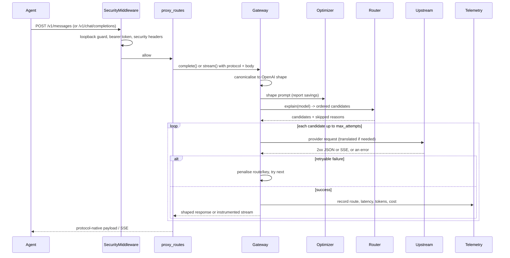

# Architecture

Hexgate is a single async process with a deliberately small number of moving parts. This
document explains how a request travels through it, and why the pieces are shaped the way they
are.

## Goals

1. **Any client, any provider.** Accept both Anthropic Messages and OpenAI Chat Completions,
   and speak to both kinds of upstream.
2. **Survive flaky providers.** Retry only what is retryable, isolate dead routes, rotate keys.
3. **Stay inspectable.** A route decision must be explainable before and after the fact.
4. **Stay small.** No database, no queue, no Node, no build step.
5. **Never leak secrets.** Keys encrypted at rest, masked in every response.

Non-goals: response caching, persistent analytics, OAuth subscription flows, multi-tenant
hosting, and being a general-purpose LLM SDK.

## Request lifecycle



## The canonical format

Everything inside the process is **OpenAI Chat Completions**. It is the widest-supported wire
format and the one most providers implement, including those that are not OpenAI.

- Anthropic requests are converted on the way in (`protocol/anthropic.py`).
- Anthropic-native upstreams are converted on the way out.
- Responses are converted on the way back, in the client's dialect.

This means the router, optimizer, health and telemetry layers only ever see one shape. Adding a
third provider protocol would mean adding one translation pair, not touching the core.

The trade-off is information loss at the edges. Fields that only exist in one dialect
(`cache_control`, thinking signatures, `top_k`) are dropped rather than forwarded blindly,
because forwarding unknown fields is how gateways get mysterious 400s. See
[compatibility.md](compatibility.md) for the full mapping.

## Streaming

Streaming is where gateways usually break, so it is handled explicitly rather than by buffering.

```
upstream bytes
   -> iter_sse()                     parse event/data pairs, tolerate CRLF and comments
   -> translator                     openai->anthropic | anthropic->openai | passthrough
   -> sse()                          serialise one frame
   -> _instrument()                  TTFT, usage capture, mid-stream error handling
   -> StreamingResponse
```

Key properties:

- **No buffering.** Frames are yielded as they arrive, with `x-accel-buffering: no` and
  `cache-control: no-cache`.
- **Both directions have state machines.** The OpenAI→Anthropic translator tracks content
  block indices, opens a block lazily on the first delta, streams tool arguments as
  `input_json_delta`, and always closes the block before `message_stop`. The reverse
  translator synthesises a role delta, maps `tool_use` starts to `tool_calls` deltas, and ends
  with a usage-bearing finish chunk plus `[DONE]`.
- **Exactly one terminator.** Some OpenAI-compatible upstreams close the socket without
  `[DONE]`. `rewrite_openai_stream` tracks whether it saw the sentinel and appends one if not,
  because agents block waiting for it.
- **Errors stay in-band.** A failure after the 200 status line cannot change the HTTP status.
  The translator emits a protocol-native error frame, then the terminator, and the record is
  marked `499 / ok=false` with the upstream message.
- **Client disconnects are recorded, not retried.** A cancelled stream is logged as
  `client disconnected`; retrying it would duplicate tokens and side effects.

`httpx.AsyncClient.send(..., stream=True)` is used with an explicit timeout, and the response is
closed in a `finally` block so abandoned streams cannot leak connections.

## Routing

`Router.explain(model)` is pure with respect to the request: it produces a `Plan` containing
ordered `Candidate`s and a list of `skipped` reasons. The same function powers the proxy, the
`/api/routes/plan` endpoint, the dashboard planner and `hexgate route`.

Resolution:

```text
provider/model  ──────────────> direct (single candidate, all keys)
claude-*-sonnet ──> sonnet chain ─┐
anything else  ──> default chain ─┼─> candidates -> dedupe -> circuit filter -> strategy order
no chains      ──> implicit      ─┘
```

- A **candidate** is a `(provider, model, api, base_url, key, key_index)` tuple. Keys are
  expanded at this stage, so key rotation and route failover share one mechanism.
- **Deduplication** is by provider/model/key index.
- **Circuit filtering** removes routes whose breaker is open. If every route is open, the plan
  still contains candidates (for the error message) but the gateway skips them.
- **Strategy ordering** is applied last: `quality` keeps declaration order, `cheapest` uses the
  price table, `fastest` uses the EWMA latency from health, `round_robin` rotates the list.

Skipped reasons are carried into the 503 message, so "no route" is actionable instead of
mysterious.

## Reliability model

Three independent mechanisms, deliberately separated:

| Mechanism | Scope | Trigger | Recovery |
| --- | --- | --- | --- |
| Retry | One request | Retryable status or network error | Next candidate immediately |
| Circuit breaker | `provider/model` | `failure_threshold` consecutive failures | Cooldown, then one half-open trial |
| Key cooldown | `provider/key_index` | 401/403, or 429 with `Retry-After` | Cooldown expires; success clears it |

The separation matters. A revoked key is **not** a broken provider: opening the route circuit
would take a healthy provider offline for every key. `_penalise()` therefore cools the key on
401/403 and leaves the circuit closed. A 429 is ambiguous, so both are cooled, with the route
cooldown capped at 15 minutes and the key cooldown at 10.

The half-open state allows exactly one in-flight trial (`trial_in_flight`), preventing a
thundering herd against a provider that just came back.

Streaming failures are subtler: if the upstream returns a non-2xx before any bytes, normal
failover applies. If it fails mid-stream, the turn has already begun; we surface the error
in-band and record it, but do not silently restart the answer.

## Telemetry and cost

`Telemetry` is a bounded `deque` of `RequestRecord`s guarded by a lock, with a `maxlen`. This is
an operations dashboard, not an audit log: the default retains 500 records, and stats are
computed on read for a window. Cost and savings are estimates from a static price table;
unknown models report `None`, never a made-up number. The "saved vs frontier" figure compares
against a fixed frontier baseline ($15/$75 per million tokens), so it is a relative indicator.

Prometheus rendering reuses the same stats with `window_seconds=0` (the whole buffer).

## Security boundaries

- `SecurityMiddleware` is a raw ASGI middleware, not a FastAPI dependency, so it also covers
  mounted static files and future routes.
- Only `/api`, `/v1` and `/metrics` are guarded. `/` and `/healthz` stay readable so the
  dashboard can load and a supervisor can probe liveness.
- Loopback is decided from the socket peer, not from `Host` or `X-Forwarded-For` (which are
  attacker-controlled). Proxies should terminate on loopback and forward deliberately.
- Proxy and admin tokens are separate; the admin token is required for `/api` and `/metrics`.
- The secret vault uses scrypt (n=2^14) to derive an AES-256-GCM key from either
  `HEXGATE_MASTER_PASSWORD` or a machine fingerprint. The ciphertext is bound to a versioned
  AAD, so a blob from another version cannot be replayed.

## Concurrency

One uvicorn worker. Requests are async and fully interleaved on the event loop; outbound HTTP
uses a shared `AsyncClient` with keep-alive pooling. Health, keyring and telemetry use short
critical sections around plain dicts/deques — no locks are held across `await`.

This is intentional: a single process keeps state coherent (circuits, cooldowns, telemetry)
without Redis, and comfortably saturates the network for a personal or small-team gateway. If
you need horizontal scale, run one gateway per agent host rather than sharing state.

## Extension points

- **New provider** — add an entry to `hexgate/data/providers.json`. No code change.
- **New OpenAI-compatible dialect quirk** — `core/upstream.py` and `protocol/openai.py`.
- **New wire protocol** — implement `x_request_to_openai`, `openai_response_to_x`, and two
  stream translators; add a branch in `Gateway._translate`.
- **New optimizer rule** — write a function in `optimizer.py` that reports its character
  savings via `report.note(rule, chars)`.
- **New admin endpoint** — add it to `server/admin_routes.py`; the `/api` prefix and auth are
  inherited.

## Known limitations

- Single process, in-memory state; restarting clears circuits, cooldowns and telemetry.
- No request queueing or concurrency limits against a provider beyond connection pooling.
- Only Chat Completions and Messages are proxied. The OpenAI Responses API, embeddings,
  batches and file APIs are not implemented.
- `count_tokens` is an estimate (about four characters per token), not a provider tokenizer.
- Prompt-caching directives are not forwarded; cached-token usage is still read when a
  provider reports it.
